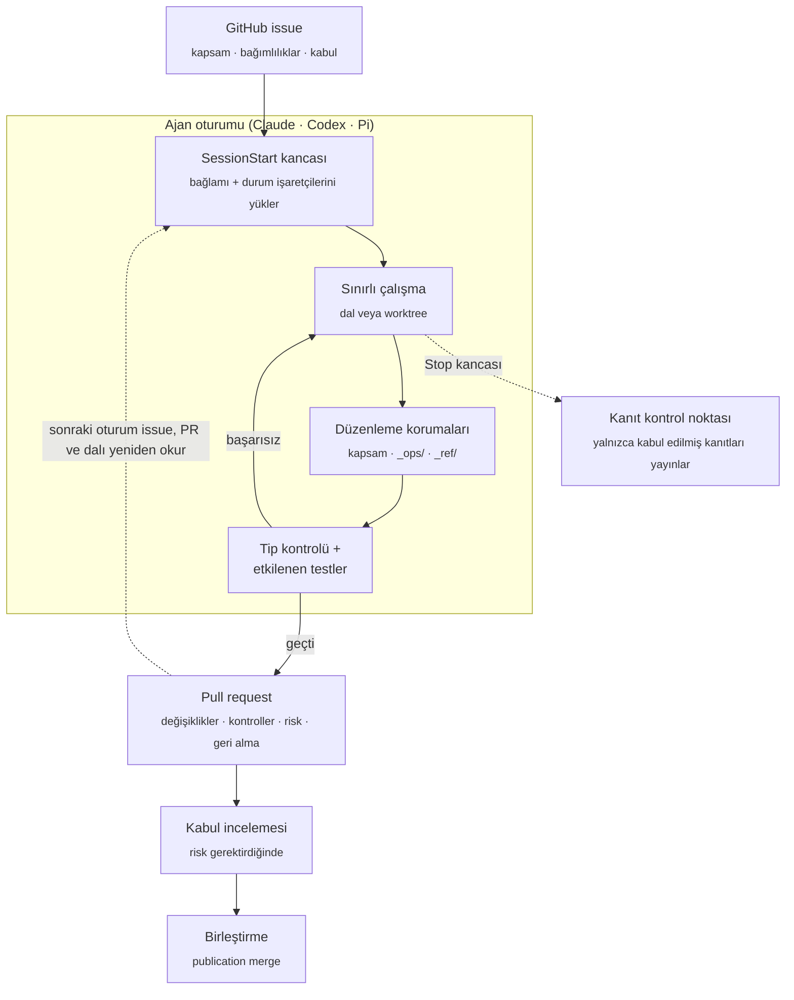
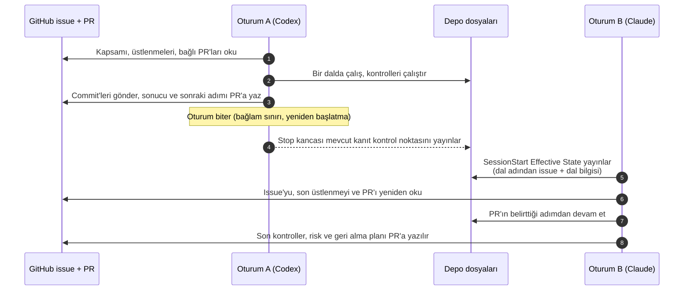
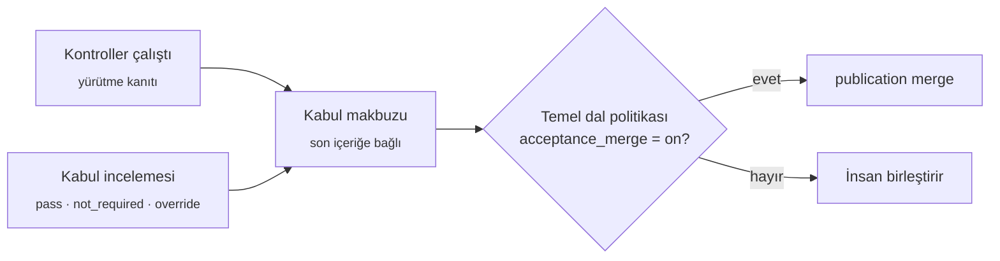

<div align="center">

# repo-harness

### Bir yapay zekâ ajanına bir GitHub issue'su verin. Gerçekten inceleyebileceğiniz bir PR geri alın.


[](https://www.npmjs.com/package/repo-harness)
[](https://opensource.org/licenses/MIT)
[](https://bun.sh)
[](#desteklenen-ortamlar)

[English](README.md) | [简体中文](README.zh-CN.md) | [日本語](README.ja.md) | [Français](README.fr.md) | [Español](README.es.md) | [Türkçe](README.tr.md)

[Hızlı başlangıç](#hızlı-başlangıç) · [Nasıl çalışır](#nasıl-çalışır) · [Komutlar](#komut-özeti) · [Kullanım kılavuzu](docs/usage.md) · [Değişiklik günlüğü](docs/CHANGELOG.md)

</div>

---

`repo-harness`, mevcut bir depoyu saran bir CLI, bir dizi kanca (hook) ve bir dizi yetenekten (skill) oluşur; böylece **Claude, Codex ve Pi** oturumlar, makineler ve worktree'ler boyunca uzun soluklu mühendislik çalışmaları yapabilir ve geride bir insanın dakikalar içinde inceleyebileceği kanıtlar bırakabilir.

Kodu yapay zekâya yazdıran ve insanın işini tek bir şeye indirgeyen bireysel geliştiriciler ve küçük ekipler için tasarlandı: **değişikliği kabul edip etmemeye karar vermek.**

## Neden

Kodlama ajanları hızlıdır, ancak iş tek bir sohbetin ötesine taştığı anda üç şey bozulur:

| Harness olmadan | repo-harness ile |
| --- | --- |
| Bağlam sohbet dizisinde yaşar ve onunla birlikte kaybolur. | Görevin sahibi **GitHub issue ve PR** olur. Yeni her oturum bunları yeniden okur ve tam olarak bir sonraki adımdan devam eder. |
| Her oturum yapıyı yeniden keşfetmek için depoyu baştan grep'ler. | ~12 KB kararlı kök bağlam, yalnızca dokunulan dosyalar için yüklenen ~1 KB **yetenek sözleşmeleri** ve çağıran/çağrılan ilişkileri için bir **CodeGraph** dizini. |
| "Bitti", yalnızca "ajan bitti dedi" anlamına gelir. | PR; **değişen dosyaları, çalıştırılan kontrolleri, kalan riski ve geri alma (rollback) planını** taşır. Yürütme kanıtı ile kabul onayı ayrı, tipli yetkilerdir. |
| Ajanlar deponun dışına veya özel klasörlere taşar. | **Tipli kancalar** düzenleme sınırını korur ve engellediklerinde bir `[Guard] reason` + bir `Fix:` satırı yazdırır. |

## Hızlı başlangıç

**Ön koşullar:** Bir Git çalışma ağacı, [Bun](https://bun.sh) ≥ 1.4.0 (kurulum betiği sizin yerinize kurar veya yükseltir) ve ortam hazırlığı için [`hc`](https://herdr.dev/) (herdr-core). macOS/Linux için `bash`, Windows için Git for Windows gerekir. Node.js gerekmez.

```bash
# 1. CLI'ı ve kullanıcı düzeyindeki kanca adaptörlerini kurun
curl -fsSL https://raw.githubusercontent.com/aimpact-inc/repo-harness/main/install.sh | sh
```

```powershell
# Windows (PowerShell)
irm https://raw.githubusercontent.com/aimpact-inc/repo-harness/main/install.ps1 | iex
```

Bun zaten kurulu mu? Bunun yerine `bunx -p repo-harness@latest rh install` komutunu kullanın.

```bash
# 2. Uyarlamak istediğiniz deponun kök dizininde: önce önizleyin, sonra uygulayın
rh init --dry-run   # yazacağı her dosyayı raporlar; hiçbir şey yazmaz
rh init
```

`init`, oluşturulan veya yenilenen öğeleri listeleyen bir `=== Migration Report ===` ve bir `--- External Tooling ---` hazırlık bloğu ile sona erer. Hepsi bu kadar — depoda Claude veya Codex'i açın, ona bir issue verin ve kancalar işi devralsın.

<details>
<summary><b><code>init</code> deponuza neler ekler</b></summary>

Temiz bir depoda çalıştırılan `rh init --dry-run` çıktısından (kısaltılmış):

```text
your-repo/
├── AGENTS.md · CLAUDE.md          # ajan kuralları, her ortam için tek bağımsız dosya
├── docs/
│   ├── spec.md                    # kararlı ürün amacı ve güvenlik sınırı
│   ├── prds/                      # ürün amacı ve tasarım özetleri
│   ├── reference-configs/         # her oturumun okuyabileceği ortak standartlar
│   ├── researches/
│   └── architecture/              # dizin, modules/, diagrams/
├── tasks/lessons.md               # tek yerel ders kayıt defteri
├── .ai/
│   ├── context/                   # capabilities.json, context-map.json
│   ├── harness/                   # workflow-contract.json (katılım işaretçisi), policy.json,
│   │                              # runs/, failures/, worktrees/, events.jsonl
│   └── hooks/README.md            # operatör-yardımcı yansıtması, dağıtıcı değil
├── deploy/                        # runbooks/, release-checklists/, sql/, …
├── _ops/                          # git tarafından yok sayılan özel operasyon durumu
└── .gitignore                     # yönetilen tek bir blok eklenir
```

Depoya hiçbir yardımcı betik kopyalanmaz. Alt depolar `rh run <helper>` komutunu çağırır.

</details>

> Yükseltme, kaldırma, Pi, Windows araç sabitleme ve temizlik ayrıntıları [kullanım kılavuzunda](docs/usage.md#install-in-depth) yer alır.

## Nasıl çalışır



Üç katman, her birinin tek bir sahibi var:

| Katman | İçinde ne bulunur | Sahibi |
| --- | --- | --- |
| **Görev otoritesi** | Kapsam, üstlenmeler, durum, bağımlılıklar, inceleme kanıtları | GitHub issue'su ve PR'ı |
| **Depo bağlamı** | `docs/spec.md`, `docs/prds/`, `docs/reference-configs/`, `tasks/lessons.md`, `.ai/context/`, `.ai/harness/` | Deponuz (`rh init` tarafından yazılır) |
| **Çalışma zamanı** | CLI, tipli kanca işleyicileri, yardımcılar (`rh run <helper>`), yetenekler | Global olarak kurulan paket — asla deponuza gömülmez |

`~/.claude/settings.json` ve `~/.codex/hooks.json` içindeki kullanıcı düzeyindeki adaptörler ortam olaylarını `repo-harness-hook`'a yönlendirir. Katılım sağlamamış depolar için kanca sessizce çıkar.

### Tek görev, iki oturum

Bir oturum görevin ortasında sona erebilir. Bir sonraki oturum — başka bir günde, ortamda veya ajanda — eski sohbetten değil daldan, issue'dan ve PR'dan devam eder. Hiçbir yerel devir dosyası yazılmaz:



## Tasarım ilkeleri

- **Sohbet yerine dosyalar.** Kalıcı gerçek issue'da, PR'da ve depo dosyalarında yaşar. Sohbet geçmişi, dökümler ve ajan belleği yalnızca önbellektir.
- **Anlatım yerine kanıt.** Geçen bir kontrol, bir komutun çalıştırıldığını kanıtlar; kabul onayı ise kendi makbuzudur. İnceleyenler önce PR açıklamasını, ardından diff'i ve iz kaydını okur.
- **Otopilot değil, korkuluklar.** Kancalar bağlamı yükler ve düzenleme sınırlarını uygular. Asla ürün kararı almaz, birleştirme yapmaz, yayınlamaz veya incelemeyi atlamaz.
- **Bot karar verir, harness sağlar.** repo-harness bir zamanlayıcı, bütçe defteri veya gözetimsiz bir denetleyici tutmaz. İşi CLI ve Herdr üzerinden Bot'unuz (veya siz) planlarsınız; repo-harness araçları ve kanıtları sağlar.
- **Yalın bağlam.** En küçük kararlı bağlamı yükler, ardından yalnızca dokunulan dosyaların ihtiyaç duyduğu yetenek bloklarını ekler.

## Neler elde edersiniz

| | |
| --- | --- |
| **Oturum sürekliliği** | Dal, issue adını taşır; issue ve PR kapsamı ve sonraki adımı tutar; böylece herhangi bir ajan özgün sohbet olmadan devam edebilir. |
| **Tipli kanca çalışma zamanı** | Her biri tam olarak bir süreç içi işleyiciye bağlı 6 açık rota (Claude 5, Codex 5). |
| **Güvenlik kancası** | `CredentialGuard` (I1), `UserFileGuard` (I2), `RecursiveDeleteGuard`, `EditScopeGuard`, `ApplyPatchScopeGuard`. |
| **Aşamalı bağlam** | ArchContext ve CodeGraph ile desteklenen kök bağlam ve yetenek bazlı sözleşmeler. |
| **Kabul incelemesi** | Bağlı bir checkout içinde kalıcı, yalıtılmış bir inceleyici; PR başına en fazla üç onarım turu. |
| **Operatör konsolu** | Görevler, depolar, ajanlar, yetenekler, kancalar ve mimari için yalnızca yerel geri döngü (loopback) web panosu. |
| **Yeniden düzenleme sinyalleri** | Kanıtlarla ölçülmüş döngüler ve katmanlama ihlalleri; kabul eder, erteler veya reddedersiniz. |
| **MCP sidecar** | Yerel bir MCP istemcisinin gerçek depo durumunu okumasına ve PRD yazmasına izin verir; varsayılan olarak kaynak koda yazma erişimi yoktur. |

## Komut özeti

| Amaç | Komut |
| --- | --- |
| Global çalışma zamanını kur / eşitle | `rh install` · `rh update` |
| Salt okunur sağlık kontrolü | `rh setup check` |
| Bir depoyu uyarla | `rh init --dry-run` → `rh init` |
| Bir iş akışı yardımcısı çalıştır | `rh run <helper>` |
| Üst issue için pano | `rh board --parent <n> --json` |
| Açık üst issue'ları listele | `rh board parents --json` |
| Yerel konsolu aç (`operator` eklentisi gerekir: `rh install --plugins <eklentileriniz>,operator`) | `rh operator serve` |
| Tamamlanan worktree'leri temizle (`operator` eklentisi gerekir) | `rh worktrees list` → `rh worktrees clean --ids … --expected-digest …` |
| Mimari bulguları / inceleme istemi | `rh arch module list --json` · `rh arch module review-prompt <capability> --json` |
| Yeniden düzenleme önerileri | `rh arch refactor recommendations` · `rh arch refactor decide <id> accept\|defer\|reject --reason "…"` |
| Kabul incelemesi | `rh review round\|status\|close …` ([ayrıntılar](docs/usage.md#persistent-acceptance-review)) |
| Kabul edilmiş PR'ı birleştir | `rh publication merge` ([politika](docs/control-bot-boundary.md#bot-modes-and-merge)) |
| MCP sidecar (`mcp` eklentisi gerekir: `rh install --plugins <eklentileriniz>,mcp`) | `rh mcp serve --repo . --profile planner` · `rh mcp doctor --repo .` |
| Başvuru belgeleri | `rh docs list` · `rh docs show harness-overview` |
| Artıkları temizle / kaldır | `rh upgrade [--apply]` · `rh uninstall --dry-run` |

## Ajan çalışmasını inceleme

PR açıklamasından başlayın: amaç, kapsam, değişiklikler, geçen komutlar, harici kabul, kalan risk ve geri alma planı. Ardından diff'i, sonra en son çalıştırma izini inceleyin. Yalnızca kontroller geçtiğinde ve harici kabul `pass`, `not_required` veya açık bir geçersiz kılma (`override`) olduğunda kabul edin.

| Ajanların ilk okudukları | İnsanların ilk inceledikleri |
| --- | --- |
| Mevcut istem ve başvurulan dosyalar | PR açıklaması |
| `AGENTS.md` / `CLAUDE.md` | Değişen dosyalar ve diff |
| GitHub issue'su ve PR'ı | Doğrulama kayıtları ve çalıştırma izi |
| Issue üzerindeki son üstlenme durumu | Kalan risk ve geri alma planı |

Özetler issue, PR veya kontrollerle çeliştiğinde kaynak belgeler geçerlidir.

Yürütme kanıtı ile kabul onayı ayrı yetkilerdir. Yeşil bir kontrol onay anlamına gelmez ve bir inceleyici kaydı tek başına birleştirme izni değildir:



## Operatör konsolu

`rh operator serve` yalnızca loopback üzerinde yerel bir web panosu başlatır. Kayıtlı tüm depolar genelinde sizden aksiyon bekleyen işleri, devam edilecekleri, aşama sayılarını ve bugünün birleştirmelerini gösterir. `all` seçiminde yer alan `operator` eklentisini gerektirir.


Konsol üç sınırlı yazma işlemi dışında salt okunurdur: yerel ajan yapılandırması, Taslak PR döndüren belge oturumları ve worktree temizliği. Kodlama oturumlarına asla mesaj göndermez veya iş dağıtmaz. Ayrıntılar: [kullanım kılavuzu](docs/usage.md#local-operator-console).

## Yetenekler

Her iki ortam da aynı yetenek adlarını alır. **Bot** yetenekleri kapsamı, çalışanları ve kabulü seçer; **Worker** yetenekleri atanan adımları yürütür.

| Yetenek | Grup | Amaç |
| --- | --- | --- |
| `repo-harness` | Bot | Açık harness eylemlerini yönlendir |
| `repo-harness-check` | Bot | Kapsamlı çalışma planla, planları incele, kayıtlı kontrolleri değerlendir |
| `repo-harness-product` | Bot | PRD taslağı ve Hedef hazırlığı |
| `repo-harness-issue-flow` | Bot | Issue/PR odaklı çok ajanlı geliştirme: böl, dağıt, CI'ı izle |
| `repo-harness-ship` | Bot | Yalnızca açık komutla yayınlama ve temizlik kararları |
| `repo-harness-sharpen` | Bot | Yalnızca açık komutla istem keskinleştirme: daha büyük değil, daha derin |
| `repo-harness-reframe` | Bot | Yalnızca açık komutla sorunu yeniden çerçeveleme: alan terimleri ve benzetmeler |
| `repo-harness-cross-review` | Bot | Genel inceleme |
| `obsidian-memory` | Bot | Yalnızca açık komutla bellek çağırma veya kalıcı kılma |
| `repo-harness-setup` | Worker | Kurulum, geçiş, onarım veya iskelet oluşturma |
| `repo-harness-test` | Worker | Kaynak testleri ve gerçek fikstürler |
| `repo-harness-architecture` | Worker | Yalnızca açık komutla model, yansıtma veya diyagram çalışması |
| `repo-harness-archimap` | Worker | `docs/architecture/archimap.html` mimari haritasını yenile |
| `windows-python-first` | Worker | Python üzerinden yerel Windows dosya ve kabuk çalışması |

Tek gerçek kaynak `assets/skill-commands/manifest.json` manifestosudur. `merge-gate` bir CLI değerlendiricisidir ve paketlenmiş bir `SKILL.md` dosyası yoktur. `hooks-init`, `docs-init` ve `create-project-dirs` iç başlatma adımlarıdır, açık komutlar değildir. Daha fazlası için [kullanım kılavuzuna](docs/usage.md#skills) bakın.

## Desteklenen ortamlar

| Ortam | Kancalar | Notlar |
| --- | --- | --- |
| **Claude** | `~/.claude/settings.json` üzerinden 5 rota | Tam oturum, düzenleme, bash, alt ajan ve Stop kapsamı |
| **Codex** | `~/.codex/hooks.json` üzerinden 5 rota | Codex Ayarları'nda kanca dosyasını güvenilir olarak işaretleyin |
| **Pi** | Oturum, bildirimler, düzenleme/yazma, bash, Stop | İsteğe bağlı; `pi` `PATH` üzerindeyse otomatik kaydedilir |

## repo-harness ne değildir

- Barındırılan bir ajan ağ geçidi, ürün çalışma zamanı veya veritabanı servisi değildir.
- Deponuzun derleme, test, dağıtım veya sürüm sürecinin yerini almaz.
- Bir zamanlayıcı değildir: kendi başına asla iş dağıtmaz veya yeniden düzenleme çalıştırmaz.
- Depoya gömülmez: alt depolar `rh run <helper>` çağırır; içlerine yardımcı betik kopyalanmaz.

## Belgeler

| Konu | Nerede |
| --- | --- |
| Ayrıntılı kurulum, güncelleme, yükseltme temizliği, kaldırma, geri alma | [`docs/usage.md`](docs/usage.md) |
| Harness genel bakışı: akış, roller, araçlar | [`harness-overview.md`](docs/reference-configs/harness-overview.md) |
| Kanca rotaları, korumalar ve hata ayıklama | [`hook-operations.md`](docs/reference-configs/hook-operations.md) |
| Ajan tabanlı geliştirme akışı (Geju, P1/P2/P3, PRD'ler) | [`agentic-development-flow.md`](docs/reference-configs/agentic-development-flow.md) |
| Kurulum profilleri ve eklentiler | [`install-profiles.md`](docs/reference-configs/install-profiles.md) |
| Bot entegrasyonu ve birleştirme politikası | [`control-bot-boundary.md`](docs/control-bot-boundary.md) |
| MCP sidecar | [`general-repo-mcp.md`](docs/reference-configs/general-repo-mcp.md) |
| Harici araçlar (herdr, CodeGraph, ArchContext) | [`external-tooling.md`](docs/reference-configs/external-tooling.md) |
| Mimari harita | [`docs/architecture/`](docs/architecture/overview.md) |
| Ürün belirtimi | [`docs/spec.md`](docs/spec.md) |

## Katkıda bulunma

```bash
git clone https://github.com/aimpact-inc/repo-harness.git ~/Projects/repo-harness
cd ~/Projects/repo-harness && bun src/cli/index.ts update
bun run check:ci   # tek CI eşdeğeri kapı
```

Kanca işleyicileri `src/cli/hook/` altında, yardımcılar `scripts/` altında, kanonik başvuru belgeleri ise `assets/reference-configs/` altında yer alır (`docs/reference-configs/` içine yansıtılır). Sürüm kanalları ve yetenek eşitleme için [bakımcı başvurusuna](docs/usage.md#maintainer-reference) bakın.

## Teşekkürler

| Araç veya depo | Kullanım amacı |
| --- | --- |
| [Hylarucoder](https://x.com/hylarucoder) / Geju | Planlama ve karar disiplininin arkasındaki P1/P2/P3 durum tespiti yöntemi |
| [TW93](https://x.com/HiTw93) tarafından geliştirilen Waza (`think`, `hunt`, `check`, `health`) | Günlük planlama, hata avı, doğrulama ve sağlık kontrolleri |
| `mermaid` | Mimari diyagramlar için yazım ve okunabilirlik incelemesi |
| [herdr](https://herdr.dev/) (`hc`) | Eş-terminal çalışma zamanı: dağıtım, iş birliği, kabul inceleyicisini barındırma |
| CodeGraph (`@colbymchenry/codegraph`) | Sembol farkındalıklı gezinme ve etki takibi |

Bunların hiçbiri paket içi bağımlılık değildir; her birinin nasıl kurulacağı için [harici araçlar](docs/reference-configs/external-tooling.md) belgesine bakın.

## Sürüm ve lisans

- npm: `repo-harness@0.38.0` · iş akışı damgası `repo-harness@0.38.0+template@0.38.0`
- Geçmiş: [`docs/CHANGELOG.md`](docs/CHANGELOG.md)
- Lisans: MIT — [`LICENSE`](LICENSE) dosyasına bakın
