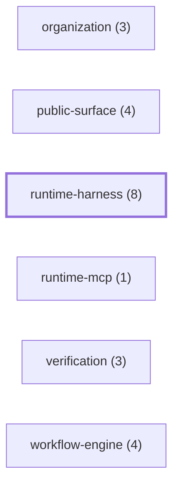
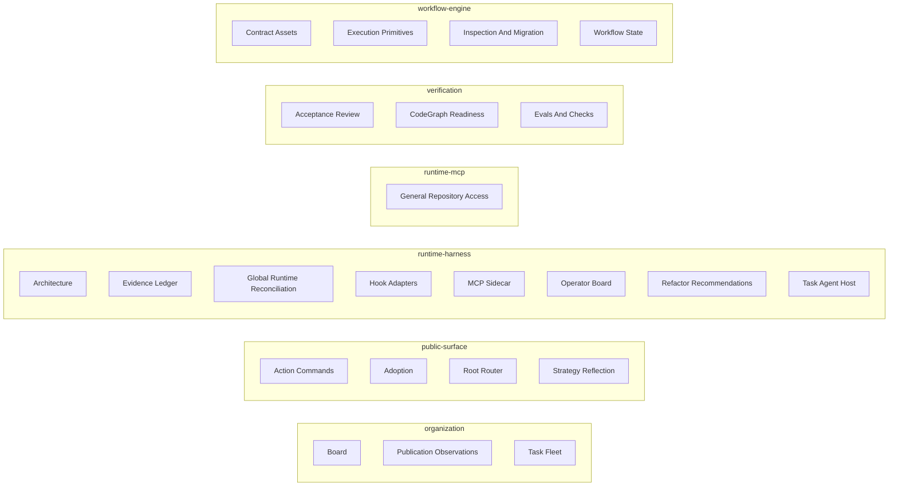
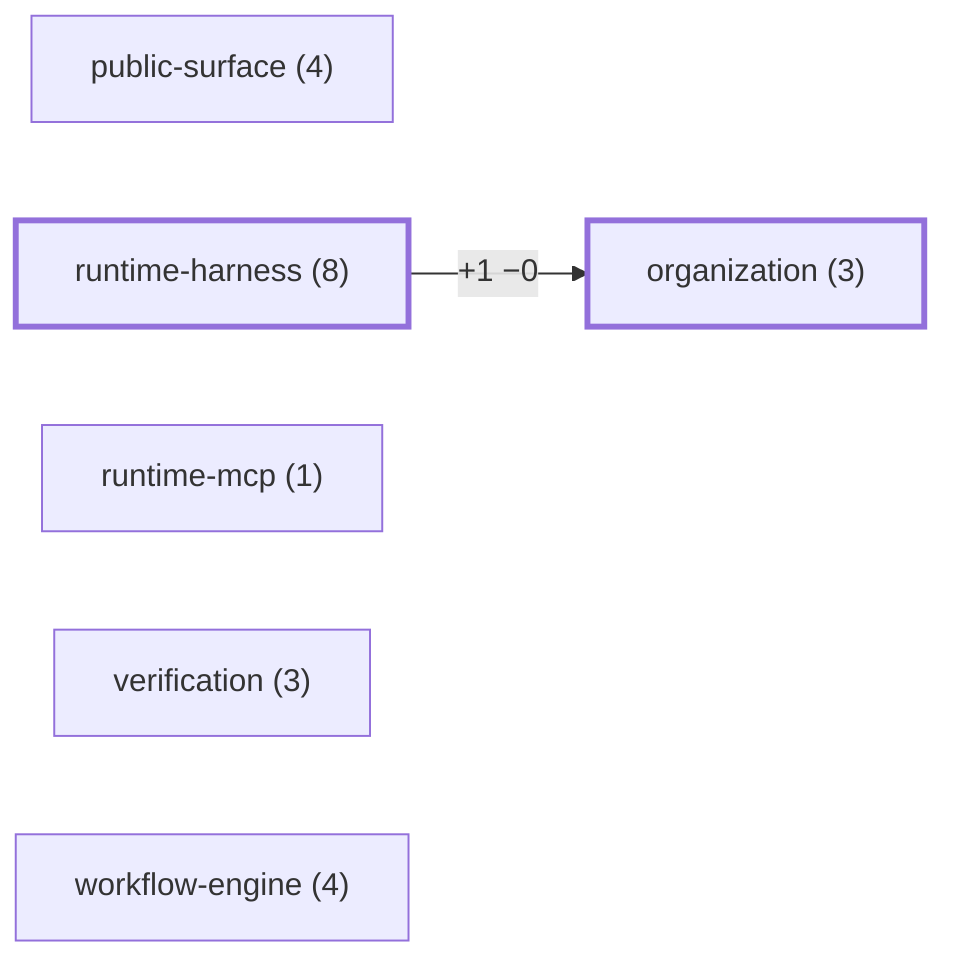
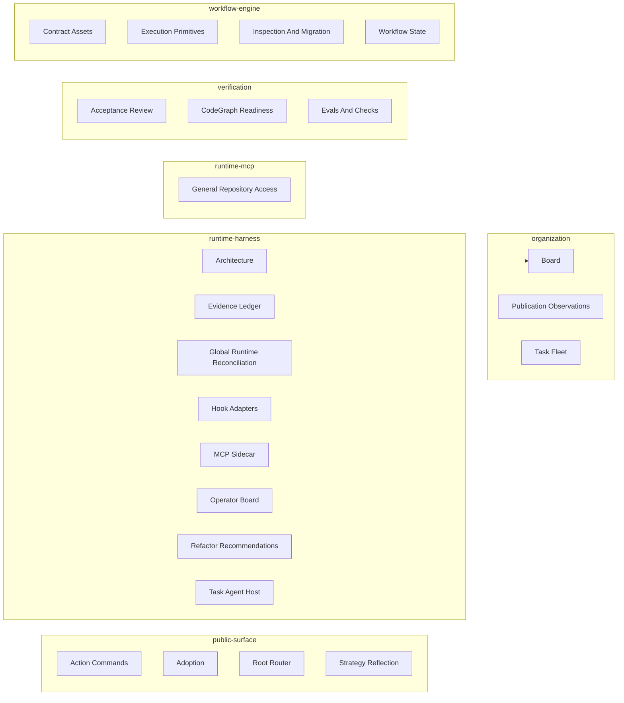
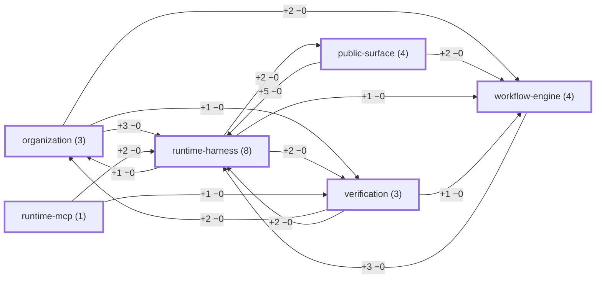
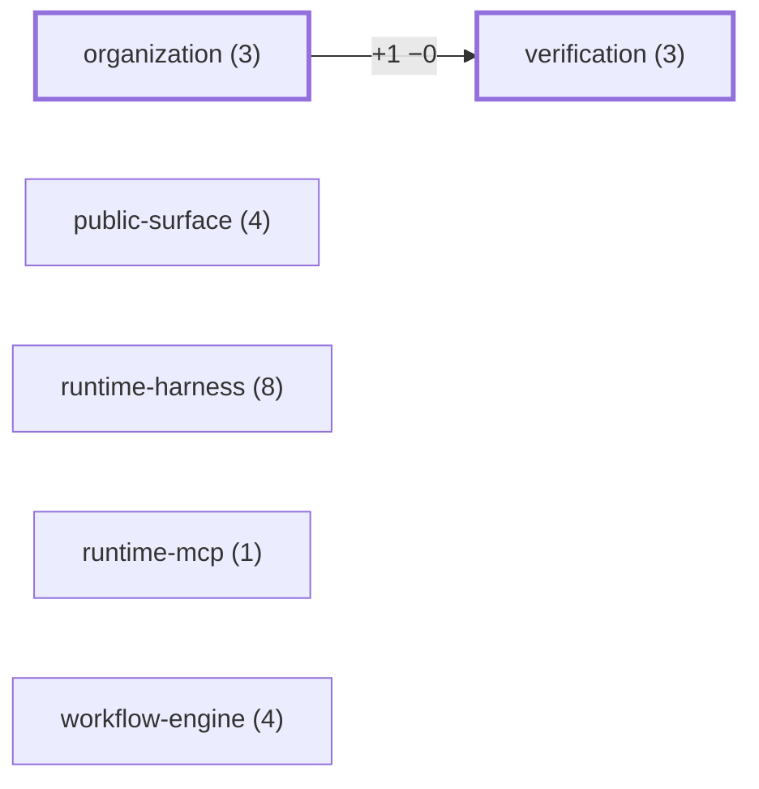
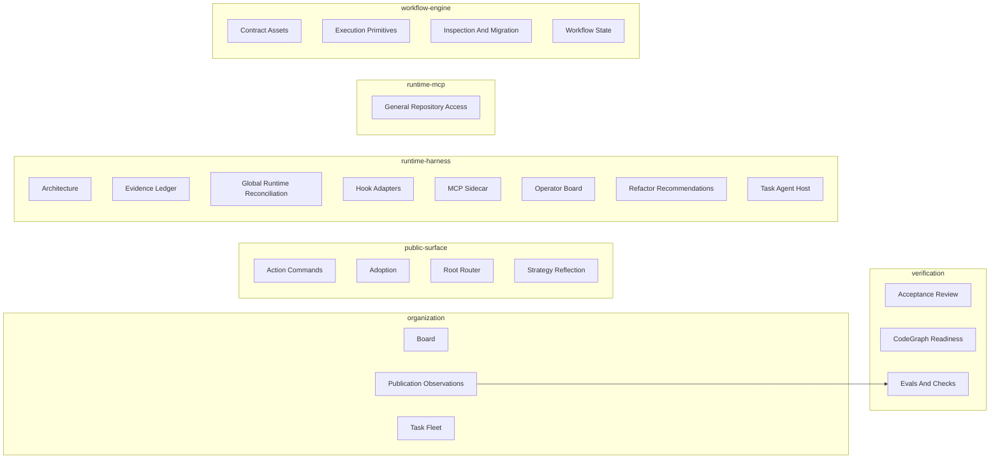
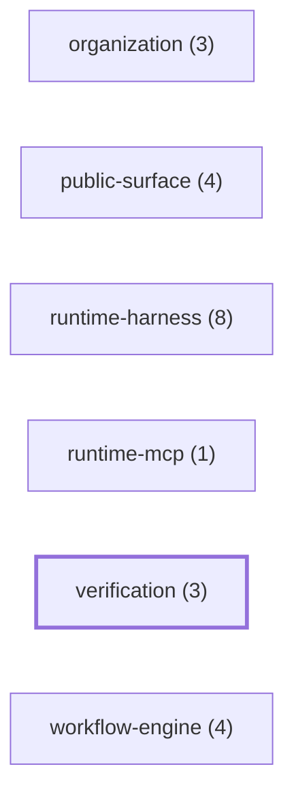

<!-- Generated by ArchContext (archctx history). Do not edit by hand. -->

Architecture history contains 90 milestones. Run `archctx history` for the full list.

## 2026-11-25 · 89c1f791c00a

refactor(arch): re-home MCP tool result and version into a shared leaf component (#3512) (#3526)

Added 1 · Removed 0 · Renamed 0 · Edges +0 −0





## 2026-11-25 · 4600c7f0cf63

refactor(architecture): move providers.ts wiring into its own component (#3511) (#3524)

Added 1 · Removed 0 · Renamed 0 · Edges +0 −0


## 2026-11-25 · 7fff398a9065

refactor(operator): break shared read dependency cycles (#3510) (#3521)

Added 1 · Removed 0 · Renamed 0 · Edges +0 −0


## 2026-11-21 · d8df9c9dee81

feat(architecture): adopt archctx 0.17.0 (#3350) (#3373)

Added 5 · Removed 5 · Renamed 0 · Edges +1 −0





## 2026-11-18 · 8943b6a3b31a

chore(architecture): declare dependencies and refresh state anchors (#3103) (#3104)

Added 0 · Removed 0 · Renamed 0 · Edges +34 −0



34 changed edges across 15 domain pairs; run archctx history --ref 8943b6a3b31a --format mermaid for the full shape.

## 2026-11-17 · f1ed65a33592

feat(publication): merge readiness consumes the TestBudget result and refuses a stale one (#2818) (#2893)

Added 0 · Removed 0 · Renamed 0 · Edges +1 −0





## 2026-11-17 · 1882f3c780a0

feat(evals-checks): expose verification through rh verify (#2865) (#2980)

Added 1 · Removed 0 · Renamed 0 · Edges +0 −0




## 2026-11-17 · 089108182913

feat(rules): file and reconcile promotion tasks (#2887) (#2961)

Added 1 · Removed 0 · Renamed 0 · Edges +0 −0


## 2026-11-16 · f68a70275440

docs(architecture): declare the host-config component and its write boundary (#2845) (#2875)

Added 2 · Removed 0 · Renamed 0 · Edges +0 −0


## 2026-11-16 · 37bb9d559205

feat(test-budget): TestBudget rule, exception parser and rules policy section (#2817) (#2856)

Added 1 · Removed 0 · Renamed 0 · Edges +0 −0


## 2026-11-11 · f40c2f62cad8

refactor(operator): remove the doc-session modules; the worktree cleanup owns its four helpers (#2457) (#2556)

Added 0 · Removed 1 · Renamed 0 · Edges +0 −0


```mermaid
flowchart LR
  subgraph "organization"
    n0["Board"]
    n1["Publication Observations"]
    n2["Task Fleet"]
  end
  subgraph "public-surface"
    n3["Action Commands"]
    n4["Adoption"]
    n5["Root Router"]
    n6["Strategy Reflection"]
  end
  subgraph "runtime-harness"
    n7["Architecture"]
    n8["Evidence Ledger"]
    n9["Global Runtime Reconciliation"]
    n10["Hook Adapters"]
    n11["MCP Sidecar"]
    n12["Operator Board"]
    n13["Refactor Recommendations"]
    n14["Task Agent Host"]
  end
  subgraph "runtime-mcp"
    n15["General Repository Access"]
  end
  subgraph "verification"
    n16["Acceptance Review"]
    n17["CodeGraph Readiness"]
    n18["Evals And Checks"]
  end
  subgraph "workflow-engine"
    n19["Contract Assets"]
    n20["Execution Primitives"]
    n21["Inspection And Migration"]
    n22["Workflow State"]
  end
```

## 2026-11-11 · 4f15b3bb680d

refactor(operator)!: remove the doc-session routes and the operator doc-sessions command (#2456) (#2494)

Added 0 · Removed 1 · Renamed 0 · Edges +0 −0

```mermaid
flowchart LR
  d0["organization (3)"]
  d1["public-surface (4)"]
  d2["runtime-harness (8)"]
  d3["runtime-mcp (1)"]
  d4["verification (3)"]
  d5["workflow-engine (4)"]
  class d2 changed
  classDef changed stroke-width:3px
```

```mermaid
flowchart LR
  subgraph "organization"
    n0["Board"]
    n1["Publication Observations"]
    n2["Task Fleet"]
  end
  subgraph "public-surface"
    n3["Action Commands"]
    n4["Adoption"]
    n5["Root Router"]
    n6["Strategy Reflection"]
  end
  subgraph "runtime-harness"
    n7["Architecture"]
    n8["Evidence Ledger"]
    n9["Global Runtime Reconciliation"]
    n10["Hook Adapters"]
    n11["MCP Sidecar"]
    n12["Operator Board"]
    n13["Refactor Recommendations"]
    n14["Task Agent Host"]
  end
  subgraph "runtime-mcp"
    n15["General Repository Access"]
  end
  subgraph "verification"
    n16["Acceptance Review"]
    n17["CodeGraph Readiness"]
    n18["Evals And Checks"]
  end
  subgraph "workflow-engine"
    n19["Contract Assets"]
    n20["Execution Primitives"]
    n21["Inspection And Migration"]
    n22["Workflow State"]
  end
```

## 2026-11-10 · 176afd079d9a

feat(operator): observe repository seats from hc events (#2163) (#2201)

Added 1 · Removed 0 · Renamed 0 · Edges +0 −0

```mermaid
flowchart LR
  d0["organization (3)"]
  d1["public-surface (4)"]
  d2["runtime-harness (8)"]
  d3["runtime-mcp (1)"]
  d4["verification (3)"]
  d5["workflow-engine (4)"]
  class d2 changed
  classDef changed stroke-width:3px
```

```mermaid
flowchart LR
  subgraph "organization"
    n0["Board"]
    n1["Publication Observations"]
    n2["Task Fleet"]
  end
  subgraph "public-surface"
    n3["Action Commands"]
    n4["Adoption"]
    n5["Root Router"]
    n6["Strategy Reflection"]
  end
  subgraph "runtime-harness"
    n7["Architecture"]
    n8["Evidence Ledger"]
    n9["Global Runtime Reconciliation"]
    n10["Hook Adapters"]
    n11["MCP Sidecar"]
    n12["Operator Board"]
    n13["Refactor Recommendations"]
    n14["Task Agent Host"]
  end
  subgraph "runtime-mcp"
    n15["General Repository Access"]
  end
  subgraph "verification"
    n16["Acceptance Review"]
    n17["CodeGraph Readiness"]
    n18["Evals And Checks"]
  end
  subgraph "workflow-engine"
    n19["Contract Assets"]
    n20["Execution Primitives"]
    n21["Inspection And Migration"]
    n22["Workflow State"]
  end
```

## 2026-11-06 · fe5519c8817e

refactor(runtime): keep closeout, the Herdr skill and the agent fleet in core (#1887) (#1903)

Added 3 · Removed 2 · Renamed 0 · Edges +1 −2

```mermaid
flowchart LR
  d0["organization (3)"]
  d1["public-surface (4)"]
  d2["runtime-harness (8)"]
  d3["runtime-mcp (1)"]
  d4["verification (3)"]
  d5["workflow-engine (4)"]
  d5 -.->|+0 −1| d2
  class d2 changed
  class d5 changed
  classDef changed stroke-width:3px
```

```mermaid
flowchart LR
  subgraph "organization"
    n0["Board"]
    n1["Publication Observations"]
    n2["Task Fleet"]
  end
  subgraph "public-surface"
    n3["Action Commands"]
    n4["Adoption"]
    n5["Root Router"]
    n6["Strategy Reflection"]
  end
  subgraph "runtime-harness"
    n7["Architecture"]
    n8["Evidence Ledger"]
    n9["Global Runtime Reconciliation"]
    n10["Hook Adapters"]
    n11["MCP Sidecar"]
    n12["Operator Board"]
    n13["Refactor Recommendations"]
    n14["Task Agent Host"]
  end
  subgraph "runtime-mcp"
    n15["General Repository Access"]
  end
  subgraph "verification"
    n16["Acceptance Review"]
    n17["CodeGraph Readiness"]
    n18["Evals And Checks"]
  end
  subgraph "workflow-engine"
    n19["Contract Assets"]
    n20["Execution Primitives"]
    n21["Inspection And Migration"]
    n22["Workflow State"]
  end
  n20 --> n22
  n14 -.-> n10
  n19 -.-> n14
```

## 2026-11-06 · 90d78227edb5

feat(publication): own GitHub App hook configuration (#1888) (#1898)

Added 0 · Removed 0 · Renamed 0 · Edges +1 −0

```mermaid
flowchart LR
  d0["organization (3)"]
  d1["public-surface (4)"]
  d2["runtime-harness (8)"]
  d3["runtime-mcp (1)"]
  d4["verification (3)"]
  d5["workflow-engine (4)"]
  d2 -->|+1 −0| d0
  class d0 changed
  class d2 changed
  classDef changed stroke-width:3px
```

```mermaid
flowchart LR
  subgraph "organization"
    n0["Board"]
    n1["Publication Observations"]
    n2["Task Fleet"]
  end
  subgraph "public-surface"
    n3["Action Commands"]
    n4["Adoption"]
    n5["Root Router"]
    n6["Strategy Reflection"]
  end
  subgraph "runtime-harness"
    n7["Architecture"]
    n8["Evidence Ledger"]
    n9["Global Runtime Reconciliation"]
    n10["Hook Adapters"]
    n11["MCP Sidecar"]
    n12["Operator Board"]
    n13["Refactor Recommendations"]
    n14["Task Agent Host"]
  end
  subgraph "runtime-mcp"
    n15["General Repository Access"]
  end
  subgraph "verification"
    n16["Acceptance Review"]
    n17["CodeGraph Readiness"]
    n18["Evals And Checks"]
  end
  subgraph "workflow-engine"
    n19["Contract Assets"]
    n20["Execution Primitives"]
    n21["Inspection And Migration"]
    n22["Workflow State"]
  end
  n14 --> n1
```

## 2026-11-05 · 7716f464c944

refactor(board): seats and quota move to core Board (#1848) (#1852)

Added 0 · Removed 0 · Renamed 0 · Edges +3 −0

```mermaid
flowchart LR
  d0["organization (3)"]
  d1["public-surface (4)"]
  d2["runtime-harness (8)"]
  d3["runtime-mcp (1)"]
  d4["verification (3)"]
  d5["workflow-engine (4)"]
  d0 -->|+1 −0| d2
  d0 -->|+2 −0| d5
  class d0 changed
  class d2 changed
  class d5 changed
  classDef changed stroke-width:3px
```

```mermaid
flowchart LR
  subgraph "organization"
    n0["Board"]
    n1["Publication Observations"]
    n2["Task Fleet"]
  end
  subgraph "public-surface"
    n3["Action Commands"]
    n4["Adoption"]
    n5["Root Router"]
    n6["Strategy Reflection"]
  end
  subgraph "runtime-harness"
    n7["Architecture"]
    n8["Evidence Ledger"]
    n9["Global Runtime Reconciliation"]
    n10["Hook Adapters"]
    n11["MCP Sidecar"]
    n12["Operator Board"]
    n13["Refactor Recommendations"]
    n14["Task Agent Host"]
  end
  subgraph "runtime-mcp"
    n15["General Repository Access"]
  end
  subgraph "verification"
    n16["Acceptance Review"]
    n17["CodeGraph Readiness"]
    n18["Evals And Checks"]
  end
  subgraph "workflow-engine"
    n19["Contract Assets"]
    n20["Execution Primitives"]
    n21["Inspection And Migration"]
    n22["Workflow State"]
  end
  n0 --> n9
  n0 --> n19
  n0 --> n20
```

## 2026-11-05 · 36f9711578ae

refactor(mcp): move shared parts out of the MCP directories (#1847) (#1851)

Added 2 · Removed 1 · Renamed 1 · Edges +1 −3

```mermaid
flowchart LR
  d0["organization (3)"]
  d1["public-surface (4)"]
  d2["runtime-harness (8)"]
  d3["runtime-mcp (1)"]
  d4["verification (3)"]
  d5["workflow-engine (4)"]
  d0 -.->|+0 −1| d2
  d2 -.->|+0 −1| d0
  d2 -.->|+0 −1| d3
  d2 -->|+1 −0| d4
  class d0 changed
  class d2 changed
  class d3 changed
  class d4 changed
  class d5 changed
  classDef changed stroke-width:3px
```

```mermaid
flowchart LR
  subgraph "organization"
    n0["Board"]
    n1["Publication Observations"]
    n2["Task Fleet"]
  end
  subgraph "public-surface"
    n3["Action Commands"]
    n4["Adoption"]
    n5["Root Router"]
    n6["Strategy Reflection"]
  end
  subgraph "runtime-harness"
    n7["Architecture"]
    n8["Evidence Ledger"]
    n9["Global Runtime Reconciliation"]
    n10["Hook Adapters"]
    n11["MCP Sidecar"]
    n12["Operator Board"]
    n13["Refactor Recommendations"]
    n14["Task Agent Host"]
  end
  subgraph "runtime-mcp"
    n15["General Repository Access"]
  end
  subgraph "verification"
    n16["Acceptance Review"]
    n17["CodeGraph Readiness"]
    n18["Evals And Checks"]
  end
  subgraph "workflow-engine"
    n19["Contract Assets"]
    n20["Execution Primitives"]
    n21["Inspection And Migration"]
    n22["Workflow State"]
  end
  n11 --> n16
  n2 -.-> n11
  n9 -.-> n15
  n11 -.-> n2
```

## 2026-11-05 · f4c2d9abe261

refactor(operator): move core-used files out of the operator directories (#1834) (#1836)

Added 4 · Removed 3 · Renamed 0 · Edges +4 −2

```mermaid
flowchart LR
  d0["organization (3)"]
  d1["public-surface (4)"]
  d2["runtime-harness (8)"]
  d3["runtime-mcp (1)"]
  d4["verification (3)"]
  d5["workflow-engine (4)"]
  d2 -->|+1 −0| d4
  d2 -->|+1 −0| d5
  d4 -.->|+0 −1| d2
  d5 -.->|+0 −1| d2
  class d2 changed
  class d4 changed
  class d5 changed
  classDef changed stroke-width:3px
```

```mermaid
flowchart LR
  subgraph "organization"
    n0["Board"]
    n1["Publication Observations"]
    n2["Task Fleet"]
  end
  subgraph "public-surface"
    n3["Action Commands"]
    n4["Adoption"]
    n5["Root Router"]
    n6["Strategy Reflection"]
  end
  subgraph "runtime-harness"
    n7["Architecture"]
    n8["Evidence Ledger"]
    n9["Global Runtime Reconciliation"]
    n10["Hook Adapters"]
    n11["MCP Sidecar"]
    n12["Operator Board"]
    n13["Refactor Recommendations"]
    n14["Task Agent Host"]
  end
  subgraph "runtime-mcp"
    n15["General Repository Access"]
  end
  subgraph "verification"
    n16["Acceptance Review"]
    n17["CodeGraph Readiness"]
    n18["Evals And Checks"]
  end
  subgraph "workflow-engine"
    n19["Contract Assets"]
    n20["Execution Primitives"]
    n21["Inspection And Migration"]
    n22["Workflow State"]
  end
  n7 --> n8
  n7 --> n16
  n7 --> n19
  n12 --> n7
  n16 -.-> n12
  n19 -.-> n12
```

## 2026-11-03 · 29b23f5421e5

refactor(operator): read module diff owners through the ownership port; owners is a plugin-internals target again (#1670) (#1682)

Added 1 · Removed 0 · Renamed 0 · Edges +0 −0

```mermaid
flowchart LR
  d0["organization (3)"]
  d1["public-surface (4)"]
  d2["runtime-harness (8)"]
  d3["runtime-mcp (1)"]
  d4["verification (3)"]
  d5["workflow-engine (4)"]
  class d2 changed
  classDef changed stroke-width:3px
```

```mermaid
flowchart LR
  subgraph "organization"
    n0["Board"]
    n1["Publication Observations"]
    n2["Task Fleet"]
  end
  subgraph "public-surface"
    n3["Action Commands"]
    n4["Adoption"]
    n5["Root Router"]
    n6["Strategy Reflection"]
  end
  subgraph "runtime-harness"
    n7["Architecture"]
    n8["Evidence Ledger"]
    n9["Global Runtime Reconciliation"]
    n10["Hook Adapters"]
    n11["MCP Sidecar"]
    n12["Operator Board"]
    n13["Refactor Recommendations"]
    n14["Task Agent Host"]
  end
  subgraph "runtime-mcp"
    n15["General Repository Access"]
  end
  subgraph "verification"
    n16["Acceptance Review"]
    n17["CodeGraph Readiness"]
    n18["Evals And Checks"]
  end
  subgraph "workflow-engine"
    n19["Contract Assets"]
    n20["Execution Primitives"]
    n21["Inspection And Migration"]
    n22["Workflow State"]
  end
```

## 2026-11-03 · 65e9d318a41e

feat(architecture): load archctx and CodeGraph only for a selected architecture plugin (#1656) (#1671)

Added 11 · Removed 0 · Renamed 0 · Edges +7 −1

```mermaid
flowchart LR
  d0["organization (3)"]
  d1["public-surface (4)"]
  d2["runtime-harness (8)"]
  d3["runtime-mcp (1)"]
  d4["verification (3)"]
  d5["workflow-engine (4)"]
  d2 -->|+2 −0| d5
  d5 -->|+1 −1| d2
  class d2 changed
  class d4 changed
  class d5 changed
  classDef changed stroke-width:3px
```

```mermaid
flowchart LR
  subgraph "organization"
    n0["Board"]
    n1["Publication Observations"]
    n2["Task Fleet"]
  end
  subgraph "public-surface"
    n3["Action Commands"]
    n4["Adoption"]
    n5["Root Router"]
    n6["Strategy Reflection"]
  end
  subgraph "runtime-harness"
    n7["Architecture"]
    n8["Evidence Ledger"]
    n9["Global Runtime Reconciliation"]
    n10["Hook Adapters"]
    n11["MCP Sidecar"]
    n12["Operator Board"]
    n13["Refactor Recommendations"]
    n14["Task Agent Host"]
  end
  subgraph "runtime-mcp"
    n15["General Repository Access"]
  end
  subgraph "verification"
    n16["Acceptance Review"]
    n17["CodeGraph Readiness"]
    n18["Evals And Checks"]
  end
  subgraph "workflow-engine"
    n19["Contract Assets"]
    n20["Execution Primitives"]
    n21["Inspection And Migration"]
    n22["Workflow State"]
  end
  n7 --> n9
  n7 --> n10
  n7 --> n20
  n7 --> n22
  n9 --> n7
  n10 --> n7
  n19 --> n7
  n19 -.-> n9
```

