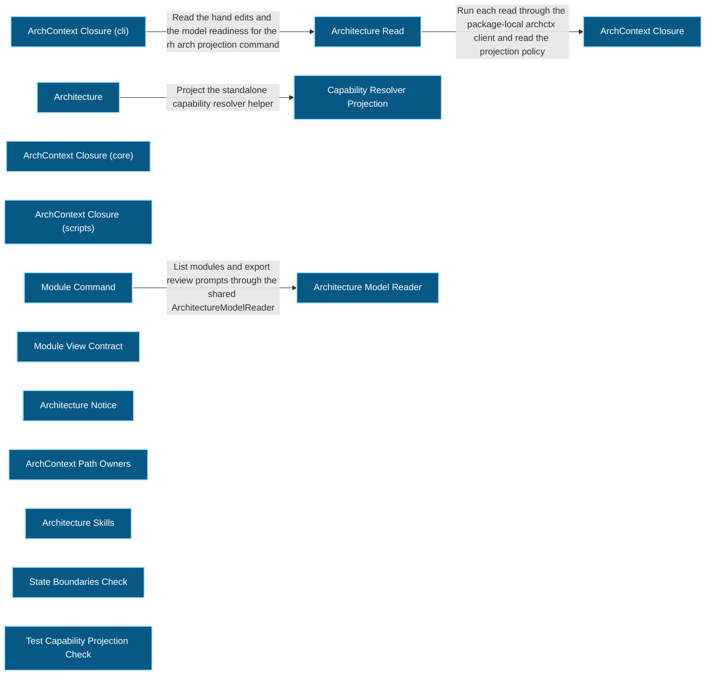
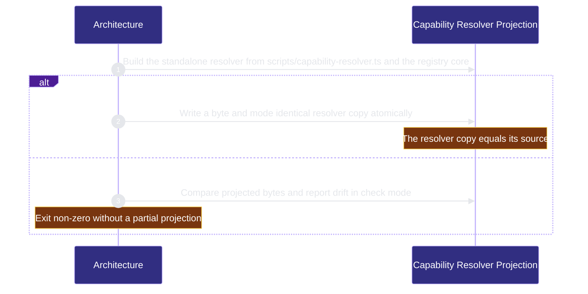

# runtime-harness/architecture 架構文檔

<!-- BEGIN ARCHCONTEXT:generated target="projection_target.entity.capability-runtime-harness-architecture" rendererVersion="archcontext.docs-renderer/v6" outputDigest="sha256:d9a3aa8a574712b05397e78030eeb641f8f206a6ccbe8f7b9345a74fd18ed235" -->
> **狀態**:`active`
> **Capability ID**:`capability.runtime-harness.architecture`(kind `capability`)
> **Matched Prefixes**:`src/effects/architecture/**`、`src/core/architecture/projection.ts`、`src/core/architecture/module-view.ts`、`src/core/review/module-review-prompt.ts`、`src/cli/commands/module.ts`、`src/cli/hook/agent-notice.ts`、`scripts/axr5-archctx-clean-room.ts`、`scripts/check-state-boundaries.ts`、`scripts/project-test-capabilities.ts`、`scripts/sync-helper-sources.ts`、`assets/skills/repo-harness-archimap/**`、`assets/skill-commands/repo-harness-architecture/**`、`docs/verification/**`
> **Local Contracts**:`AGENTS.md`、`CLAUDE.md`
> **事實優先級**:倉庫當前狀態 > 本文檔機器區 > 本文檔人工區。機器區(引言、§1、§2)由 ArchContext 從架構模型與源碼度量投影生成,手改會在下次投影被覆蓋。本文檔不記錄出處;本次投影所驗證的 commit 見 `docs/architecture/.projection-manifest.json`。

The Architecture plugin: the rh arch command tree, the pinned archctx closure, architecture reads and checks, the task posture notice and the architecture skills.

## 1. P1:能力架構地圖

### 1.1 架構圖

- Proof: `proven` (`sha256:afde94c9f73fb6afd4557d78d1461268fbb8b6bfbf2be367d28608ff400a198c`).
- Semantic nodes: `15`; declared relations: `4`.

### 1.2 模組職責表

| 宣告入口 | 錨點 | 職責 |
| --- | --- | --- |
| `entrypoint.architecture.command` | `src/cli/commands/arch-actions.ts#runArch` | `sink.architecture.command` → `src/effects/architecture/archctx-provider.ts#runArchctxPassThrough` |
| `entrypoint.architecture.verify` | `src/cli/commands/arch-verify.ts#archVerify` | `sink.architecture.verify` → `src/effects/architecture/architecture-read.ts#readArchVerification` |
| `entrypoint.architecture.helper-projection` | `scripts/sync-helper-sources.ts#main` | `sink.architecture.capability-projection` → `scripts/sync-helper-sources.ts#buildCapabilityProjection`、`sink.architecture.projection-write` → `src/effects/source-projection.ts#writeProjectionFileAtomic`、`sink.architecture.projection-compare` → `src/effects/source-projection.ts#sameProjectionBytes` |
| `entrypoint.architecture.writer` | `src/cli/commands/architecture-projection-actions.ts#publish` | `sink.architecture.writer` → `src/effects/architecture/projection-writer.ts#runArchitectureWriter` |

組件入口:

- 組件均未宣告 `source.entrypoints`。

### 1.3 規模信號

- 規模量級:`20–50` 個文件 / `5000–10000` 行
- 匹配前綴:`src/effects/architecture/**`、`src/core/architecture/projection.ts`、`src/core/architecture/module-view.ts`、`src/core/review/module-review-prompt.ts`、`src/cli/commands/module.ts`、`src/cli/hook/agent-notice.ts`、`scripts/axr5-archctx-clean-room.ts`、`scripts/check-state-boundaries.ts`、`scripts/project-test-capabilities.ts`、`scripts/sync-helper-sources.ts`、`assets/skills/repo-harness-archimap/**`、`assets/skill-commands/repo-harness-architecture/**`、`docs/verification/**`
- 排除前綴:`src/effects/architecture/capability-resolver.ts`
- 推導:掃描 `source.include` 減 `source.exclude`,跳過 `.git/` 與 `node_modules/`,再按 1–2–5 階梯分桶。精確計數不入本文檔:量級足以回答「這個能力有多大」,而逐行計數會讓覆蓋範圍內任何一次源碼改動都改寫本文檔。

### 1.4 依賴邊界

出向關係:

- `calls` → `component.architecture.helper-projection` — Project the standalone capability resolver helper
- `depends-on` → `capability.public-surface.adoption` — Resolve the source checkout for the projection writer.
- `depends-on` → `capability.organization.board` — Resolve the GitHub repository for projection slice base links.
- `depends-on` → `capability.verification.evals-checks` — Read CI coverage selection and test reports for capability projection.
- `depends-on` → `capability.workflow-engine.inspection-migration` — Use the shared clean-room runtime for the architecture probe.

入向關係:

- `depends-on` ← `capability.verification.evals-checks` — Verify architecture commands, providers and notices.
- `depends-on` ← `capability.runtime-harness.refactor-program` — Use the shared ArchContext provider and projection contracts for refactor checks.

組件出向關係:

- `component.architecture.archctx-closure`:
  - `calls` → `capability.workflow-engine.execution-primitives` — Run the archctx binary through the process runner
  - `calls` → `component.global-runtime-reconciliation.global-configuration` — Read the architecture section through the global configuration store
  - `calls` → `capability.runtime-harness.hook-adapters` — Write the private global configuration through the installer ownership writer
  - `reads` → `capability.workflow-engine.workflow-state` — Read the capability ownership type for archctx resolve results
- `component.architecture.archctx-closure-cli`:
  - `calls` → `component.architecture.architecture-read` — Read the hand edits and the model readiness for the rh arch projection command
- `component.architecture.archctx-closure-core`:
  - 無。
- `component.architecture.archctx-closure-scripts`:
  - 無。
- `component.architecture.architecture-read`:
  - `calls` → `component.architecture.archctx-closure` — Run each read through the package-local archctx client and read the projection policy
- `component.architecture.helper-projection`:
  - 無。
- `component.architecture.model-reader`:
  - `reads` → `capability.workflow-engine.contract-assets` — Plugin → core: decode the capability registry from the native context and resolve changed paths to capability owners
  - `depends-on` → `capability.runtime-harness.evidence-ledger` — Plugin → core: canonicalize the dirty worktree digest and the stale citations of a review prompt
  - `reads` → `component.execution-primitives.repository-registry` — Plugin → core: resolve the registered repository id of the read checkout
- `component.architecture.module-cli`:
  - `calls` → `component.architecture.model-reader` — List modules and export review prompts through the shared ArchitectureModelReader
- `component.architecture.module-view`:
  - `depends-on` → `capability.verification.acceptance-review` — Plugin → core: apply the shared review finding rules in module review prompts
  - `depends-on` → `capability.runtime-harness.evidence-ledger` — Plugin → core: canonicalize module review prompt digests
  - `depends-on` → `component.execution-primitives.secret-patterns` — Plugin → core: refuse module review context that contains a secret
- `component.architecture.notice`:
  - 無。
- `component.architecture.owners`:
  - 無。
- `component.architecture.skills`:
  - 無。
- `component.architecture.state-boundaries-check`:
  - 無。
- `component.architecture.test-projection-check`:
  - 無。

### 1.5 組件結構

| 組件 | 名稱 | 規模量級 | 宣告入口 |
| --- | --- | --- | --- |
| `component.architecture.archctx-closure` | ArchContext Closure | `10–20` 個文件 / `2000–5000` 行 | 未宣告 |
| `component.architecture.archctx-closure-cli` | ArchContext Closure (cli) | `5–10` 個文件 / `500–1000` 行 | 未宣告 |
| `component.architecture.archctx-closure-core` | ArchContext Closure (core) | `2–5` 個文件 / `500–1000` 行 | 未宣告 |
| `component.architecture.archctx-closure-scripts` | ArchContext Closure (scripts) | `1–2` 個文件 / `200–500` 行 | 未宣告 |
| `component.architecture.architecture-read` | Architecture Read | `1–2` 個文件 / `200–500` 行 | 未宣告 |
| `component.architecture.helper-projection` | Capability Resolver Projection | `1–2` 個文件 / `200–500` 行 | 未宣告 |
| `component.architecture.model-reader` | Architecture Model Reader | `1–2` 個文件 / `200–500` 行 | 未宣告 |
| `component.architecture.module-cli` | Module Command | `1–2` 個文件 / `50–100` 行 | 未宣告 |
| `component.architecture.module-view` | Module View Contract | `2–5` 個文件 / `200–500` 行 | 未宣告 |
| `component.architecture.notice` | Architecture Notice | `1–2` 個文件 / `500–1000` 行 | 未宣告 |
| `component.architecture.owners` | ArchContext Path Owners | `2–5` 個文件 / `200–500` 行 | 未宣告 |
| `component.architecture.skills` | Architecture Skills | `5–10` 個文件 / `1000–2000` 行 | 未宣告 |
| `component.architecture.state-boundaries-check` | State Boundaries Check | `1–2` 個文件 / `1000–2000` 行 | 未宣告 |
| `component.architecture.test-projection-check` | Test Capability Projection Check | `1–2` 個文件 / `100–200` 行 | 未宣告 |

## 2. P2:端到端數據流

> **Proof**: `proven` (`sha256:afde94c9f73fb6afd4557d78d1461268fbb8b6bfbf2be367d28608ff400a198c`); selectors `3/3`.

<!-- END ARCHCONTEXT:generated target="projection_target.entity.capability-runtime-harness-architecture" -->

## 3. P3:設計決策與不變量

### 3.1 必须保持的不变量

1. **包内 `archctx` 与 Node 版本门禁。** 所有架构读写、投影与核验只运行包内精确版本的 `archctx`（`ARCHCTX_REQUIRED_VERSION`，`src/core/architecture/projection.ts`）。`resolveCompatibleNodeRuntime` 按 `REPO_HARNESS_NODE_BIN`、`PATH`、受信任候选列表的顺序探测兼容版本，并在未传自定义候选源且无超紧截止预算（> 5 s）时按 `(REPO_HARNESS_NODE_BIN, PATH, PATHEXT)` 进程内记忆化（`src/effects/architecture/archctx-provider.ts`）。
2. **`rh arch` 处置表是唯一入口。** `ARCHCTX_COMMAND_DISPOSITIONS` 覆盖 `archctx help` 的全部命令并只放行 `pass` 命令；`projection`、`debt`、`refactor`、`recommendations` 归 `owned`，`install`、`uninstall`、`update`、`hooks`、`mcp`、`tunnel`、`audit`、`investigate`、`agents`、`jobs`、`hook` 在启动子进程前按 `refused` 退出码 2 拒绝（`src/core/architecture/projection.ts`、`src/cli/commands/arch-actions.ts`）。
3. **只读核验与写投影严格分离。** `readArchVerification`（`rh arch verify`）与 `readArchitectureView` 只调用只读命令并保留上游错误码与消息（`src/effects/architecture/architecture-read.ts`）。`projection apply` 和 `adopt` 受策略开关控制，并在提交后以 `readback` 与 `receiptDigest` 验证（`src/effects/architecture/projection-apply.ts`）。
4. **Core 与 Plugin 通过契约端口解耦。** `src/core/**` 只通过 `src/core/architecture/contracts.ts` 的注册端口访问 `ownership`、`display`、`notice`、`runtime`、`setup`、`codegraph`；未选择 `architecture` 插件时返回类型化不可用状态，从不直接导入插件实现。
5. **模型就绪与 Hook 通知在预算内 Fail Closed/Open。** `inspectArchitectureProjectionReadiness` 在清单不兼容、CodeGraph 未就绪或守护进程版本不匹配时阻止 `apply`。`AgentNotice` 严格受限于 3 s 预算、单行诊断与脱敏输出。
6. **辅助投影与边界检查字节一致。** `scripts/sync-helper-sources.ts`、`scripts/check-state-boundaries.ts` 和 `scripts/project-test-capabilities.ts` 确保独立解析器投影与分层依赖规则无漂移。

### 3.2 关键权衡

| 决策 | 权衡 |
| --- | --- |
| 按环境元组记忆化 `resolveCompatibleNodeRuntime` | 同进程多次 `ArchctxClient` 调用只探测一次 `node --version`；仅当未注入自定义候选源且剩余预算大于 5 s 时命中缓存，避免测试替身与紧截止探针读取过期路径。 |
| 退役 `#2869` 的 `held` 处置状态 | 将 `audit`、`investigate`、`agents`、`jobs` 归入 `refused`（指向 `rh seats` 与 `repo-harness-issue-flow`），将 `hook` 归入 `refused`（指向 `rh install`），删除 `held` 分支使处置表只有 `pass`、`owned`、`refused` 三态。 |
| 面向端口注册而非静态直接调用 | 核心层可独立于安装插件进行单测与边界校验；代价是 CLI/Hook 入口必须显式调用 `registerArchitecturePorts`。 |

## 4. 歷史決策記錄(append-only)

### Node 探针记忆化与 `#2869` 处置收口（2026-11-20，#3346）

- `resolveCompatibleNodeRuntime` 对默认候选源与宽松截止时间按 `(REPO_HARNESS_NODE_BIN, PATH, PATHEXT)` 进程内记忆化，消除同一进程重复派生 `node --version`。
- 将 `audit`、`investigate`、`agents`、`jobs` 与 `hook` 从 `held` 改为 `refused`，移除 `ArchctxDisposition` 中的 `held` 变体。

## Optimization Backlog

- 保持各架构子命令对 `ArchctxClient` 错误信封与 `ArchctxClientError` 类型字段的直接透传，避免在下游调用点重复包裹错误文本。
