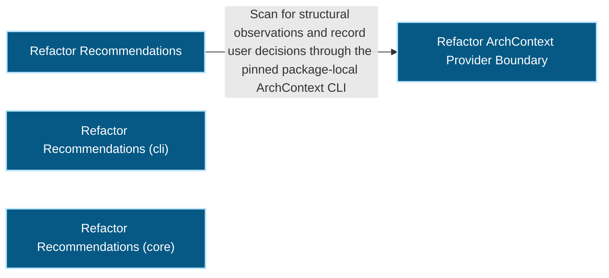
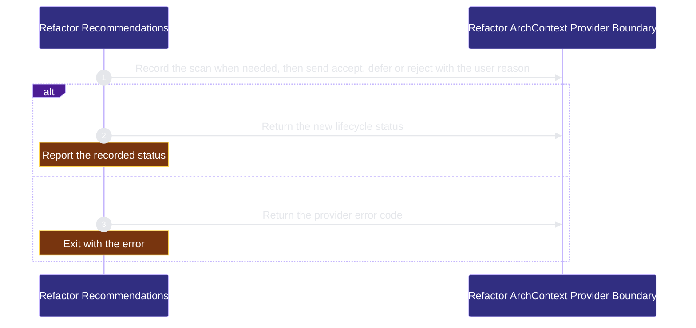
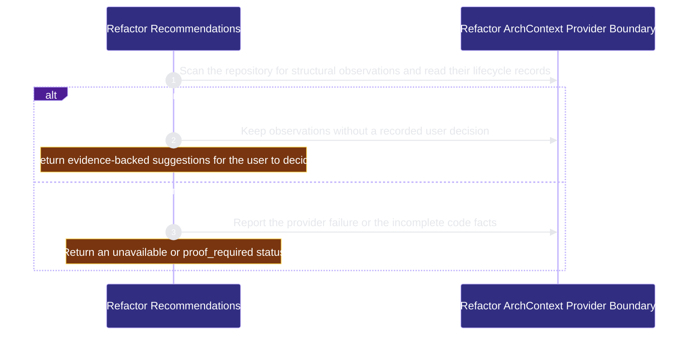

# Refactor Program
<!-- BEGIN ARCHCONTEXT:generated target="projection_target.entity.capability-runtime-harness-refactor-program" rendererVersion="archcontext.docs-renderer/v6" outputDigest="sha256:3174c5f17b28c8ec7adc5e5ff594366430556a105c99717280ee2756fb2e9438" -->
> **狀態**:`active`
> **Capability ID**:`capability.runtime-harness.refactor-program`(kind `capability`)
> **Matched Prefixes**:`src/effects/refactor/**`
> **Local Contracts**:`AGENTS.md`、`CLAUDE.md`
> **事實優先級**:倉庫當前狀態 > 本文檔機器區 > 本文檔人工區。機器區(引言、§1、§2)由 ArchContext 從架構模型與源碼度量投影生成,手改會在下次投影被覆蓋。本文檔不記錄出處;本次投影所驗證的 commit 見 `docs/architecture/.projection-manifest.json`。

Shows measured ArchContext refactor suggestions with their evidence and records the user decision; it never executes a refactor.

## 1. P1:能力架構地圖

### 1.1 架構圖

- Proof: `proven` (`sha256:70a38496c9eaffdca240305700abe006db7aefb5f82b9de25a2b4e4505d490b0`).
- Semantic nodes: `4`; declared relations: `1`.

### 1.2 模組職責表

| 宣告入口 | 錨點 | 職責 |
| --- | --- | --- |
| `entrypoint.refactor-program.observe` | `src/effects/refactor/recommendations.ts#discoverRefactorRecommendations` | `sink.refactor-program.provider-scan` → `src/effects/refactor/archctx-provider.ts#runRefactorScan` |
| `entrypoint.refactor-program.decide` | `src/cli/commands/refactor-actions.ts#decideRefactorRecommendation` | `sink.refactor-program.decision` → `src/effects/refactor/archctx-provider.ts#decideRecommendation` |

組件入口:

- 組件均未宣告 `source.entrypoints`。

### 1.3 規模信號

- 規模量級:`2–5` 個文件 / `100–200` 行
- 匹配前綴:`src/effects/refactor/**`
- 推導:掃描 `source.include` 減 `source.exclude`,跳過 `.git/` 與 `node_modules/`,再按 1–2–5 階梯分桶。精確計數不入本文檔:量級足以回答「這個能力有多大」,而逐行計數會讓覆蓋範圍內任何一次源碼改動都改寫本文檔。

### 1.4 依賴邊界

出向關係:

- `calls` → `component.refactor-program.archctx-provider` — Scan for structural observations and record user decisions through the pinned package-local ArchContext CLI
- `depends-on` → `capability.runtime-harness.architecture` — Use the shared ArchContext provider and projection contracts for refactor checks.
- `depends-on` → `capability.workflow-engine.contract-assets` — Type the archctx provider options with the core architecture contract
- `calls` → `component.execution-primitives.repository-registry` — Resolve the canonical repository path through the repo registry

入向關係:

- `depends-on` ← `capability.verification.evals-checks` — Test Refactor Recommendations behavior through its source modules.
- `calls` ← `component.global-runtime-reconciliation.cli-root` — Register the rh arch refactor command

組件出向關係:

- `component.refactor-program.archctx-provider`:
  - `calls` → `capability.runtime-harness.evidence-ledger` — Canonicalize refactor provider records
  - `calls` → `capability.runtime-harness.global-runtime-reconciliation` — Run the pinned package-local archctx CLI through the shared architecture provider
- `component.refactor-program.cli-layer`:
  - 無。
- `component.refactor-program.core-layer`:
  - 無。

### 1.5 組件結構

| 組件 | 名稱 | 規模量級 | 宣告入口 |
| --- | --- | --- | --- |
| `component.refactor-program.archctx-provider` | Refactor ArchContext Provider Boundary | `1–2` 個文件 / `50–100` 行 | 未宣告 |
| `component.refactor-program.cli-layer` | Refactor Recommendations (cli) | `2–5` 個文件 / `100–200` 行 | 未宣告 |
| `component.refactor-program.core-layer` | Refactor Recommendations (core) | `1–2` 個文件 / `50–100` 行 | 未宣告 |

## 2. P2:端到端數據流

> **Proof**: `proven` (`sha256:70a38496c9eaffdca240305700abe006db7aefb5f82b9de25a2b4e4505d490b0`); selectors `2/2`.

<!-- END ARCHCONTEXT:generated target="projection_target.entity.capability-runtime-harness-refactor-program" -->
## 3. P3:設計決策與不變量

### 3.1 必须保持的不变量

1. **ArchContext 是结构观测的唯一权威。** repo-harness 不计算模块统计、依赖、环、重构评分或规模。建议的 id、生命周期状态和度量都来自 `archctx refactor scan` 和 `recommendations list`（`src/effects/refactor/archctx-provider.ts`）。`--node` 与 `--path` 只构造 `RefactorScopeV1` 传给 `refactor scan`，由 ArchContext 执行过滤。
2. **只展示同一次扫描的证据。** 每条建议带上产生它的观测度量和受影响模块的统计（`src/effects/refactor/recommendations.ts`）。repo-harness 不合成其他内容。
3. **有决定的建议不再显示。** 只读取 `recommendations list --status open` 与尚未被记录的扫描候选；已决定的建议由 ArchContext 过滤。repo-harness 不保存投递账本、冷却时间或本地建议状态。
4. **证据不完整时不给建议。** code facts 不完整、达到 import limit 或被截断时返回 `proof_required`（`src/effects/refactor/recommendations.ts`）。`multiplyOwnedFileCount > 0` 时也返回 `proof_required`，防止重复计数污染统计；模型未初始化时返回 `unavailable`。
5. **只记录用户决定，从不执行重构。** `rh arch refactor decide` 把 `accept`、`defer` 或 `reject` 连同理由交给 ArchContext（`src/cli/commands/refactor.ts`、`src/cli/commands/refactor-actions.ts`）。接受的建议走普通的 plan 和 PR 流程。
6. **建议是按需证据，不是推送。** 没有 hook 扫描建议。Bot 调用 `rh arch refactor recommendations --json` 读取证据，再决定是否调度工作（PR #617；`assets/skill-commands/repo-harness-check/references/architecture-evidence.md`）。
7. **包内 archctx 统一经 `ArchctxClient` 校验并透传类型化错误。** `ArchctxClient` 已校验 `archcontext.envelope/v1` 与精确版本；provider 保留 `ArchctxClientError` 的 `code`、`reasonCode`、`action` 与 `providerMessage` 到 `RefactorProviderError`，超时转成 `refactor_provider_timeout`（动作为 `raise-timeout-and-retry`），非类型化过程异常转成 `refactor_provider_unavailable`。

### 3.2 关键权衡

| 决策 | 权衡 |
| --- | --- |
| 删除 Refactor Program 执行栈（PR #617） | 没有 skill 或 MCP 工具使用它，Stop 也只打印 `recommended: undefined`。删除后本 capability 只剩 4 个文件。代价是接受的建议要由 Bot 或人重新写成 plan。 |
| 多归属文件存在时一律 `proof_required` | 不会给出基于重复计数的建议。在当前 `main`（206 个节点）上 `multiplyOwnedFileCount = 0`，不再因历史多归属文件阻塞；当模型出现多归属或 CodeGraph 索引未就绪时仍 fail closed 返回 `proof_required`。 |
| 支持 `--node` 与可重复 `--path` 范围参数 | 调用方可在不重写 `.archcontext` 模型的情况下按节点或 repo-relative POSIX 路径聚焦扫描，两者互斥且在参数校验阶段拒绝混合或非法路径；代价是 `recommendations list --status open` 仍返回全库 open 记录，只对本次 scan 应用 `RefactorScopeV1`。 |
| `decide` 由 ArchContext 校验并在必要时隐式记录 | 未知或陈旧 id 由 `AC_REFACTOR_STALE` 等上游错误码与 `reasonCode` 原样返回；需要按扫描相同 `--import-node-limit` 调用 `decide`。 |
| CLI 退出码区分证据状态 | `unavailable` 和 `proof_required` 退出码为 1（`src/cli/commands/refactor.ts`），调用方不解析 JSON 也能区分证据不可用与 `no_action`。 |

### 3.3 组件与关系（2026-11-20）

| 节点 | footprint | 说明 |
| --- | --- | --- |
| `component.refactor-program.archctx-provider` | `src/effects/refactor/archctx-provider.ts` | 构造 `RefactorScopeV1`、调用 `runPackageLocalArchctxJson` 扫描与提交决定 |
| `component.refactor-program.core-layer` | `src/core/refactor/**` | `RefactorProviderError`、`normalizeRefactorScope`、响应负载拆包 |
| `component.refactor-program.cli-layer` | `src/cli/commands/refactor.ts`、`src/cli/commands/refactor-actions.ts` | `--node` / `--path` 参数校验、文本与 JSON 格式化、decision 入口 |
| capability 自身 | `src/effects/refactor/recommendations.ts` | 合并扫描与 open 记录、proof 门判定 |

对外关系：

- archctx-provider → `global-runtime-reconciliation`：调用 `runPackageLocalArchctxJson` 与 `commandLabel`（`src/effects/refactor/archctx-provider.ts`）。
- capability → `mcp-sidecar`：`refactor.ts` 用 `canonicalRepoPath` 解析仓库根。

### 3.4 开放问题

- `src/effects/refactor/archctx-provider.ts` 引用 `src/core/evidence/canonical-json.ts`（归 `evidence-ledger`）规范化 `--request-json`。

## Verification

Run the root required checks and the focused tests recorded in the capability node.

## 4. 历史决策记录（append-only）

### 执行栈退役，只保留证据和决定（2026-10-11，PR #617）

- 删除事件链状态机、授权 grant、Sprint 与 Work Package 物化、激活 canary、Codex shadow author、候选验证、执行绑定和合并后解决，以及 81 个测试。
- `refactor recommendations` 显示建议和同一次扫描的度量。`refactor decide <id> accept|defer|reject --reason` 记录决定。
- Stop 不再扫描建议，全局 `refactor_recommendations` 设置被删除。证据由 Bot 按需读取。
- 恢复多归属文件的 proof 门：`multiplyOwnedFileCount > 0` 时返回 `proof_required`。

### 范围读取、多归属清零与错误透传（2026-11-20，#3346）

- `main` 模型重构后 206 个节点的 `multiplyOwnedFileCount` 已降为 `0`，文档中"45 个多归属文件阻塞推荐"的过期描述移除。
- `rh arch refactor recommendations` 新增互斥的 `--node <nodeId>` 与可重复 `--path <repo-relative-path>`，通过 `RefactorScopeV1` 透传给 `archctx refactor scan`。
- `src/effects/refactor/archctx-provider.ts` 不再跳过 `ArchctxClient` 的错误信封解码，改由 `RefactorProviderError` 保留上游 `code`、`reasonCode` 与 `action`。

### 旧版 P3 原文（2026-10-11 之前，逐字保留）

旧版最后一条与 PR #617 的最终状态冲突：Stop 已不再扫描建议，所以"Stop 时静默"不再适用。

> - repo-harness has no local module statistics, dependency analysis, cycle detection, refactor scoring or scale inference. ArchContext owns structural observations, recommendation identity and lifecycle status.
> - A suggestion is shown with the evidence of the scan that produced it: the observation metrics and the statistics of each affected module. Nothing else is synthesized.
> - repo-harness keeps no delivery ledger, cooldown or local recommendation state. A suggestion with a recorded decision (accepted, rejected, deferred, waived, resolved, superseded, expired) is not shown again.
> - `decide` records the scan in ArchContext only when the suggestion is not yet recorded, then sends the decision with the user's reason.
> - repo-harness never executes a refactor. An accepted suggestion goes through the normal plan and pull request workflow. The previous Refactor Program (state machine, materialization, activation canaries, execution binding, post-merge resolution) was deleted on 2026-10-10.
> - An unavailable provider is silent at Stop, so repositories without an architecture model see no noise. Incomplete code facts print `proof_required` with the `codegraph init` remedy.

## Optimization Backlog

- capability 名称仍是 "Refactor Recommendations"，id 仍是 `refactor-program`。id 是持久数据键，按用户决定不改名。文档和 Bot 引用时需要说明两者对应。
- 后续待 `Ancienttwo/arch-context#619` 与 `0.17` 切面到位后，评估 `decide` 免重复全库扫描的 daemon 缓存路径。
